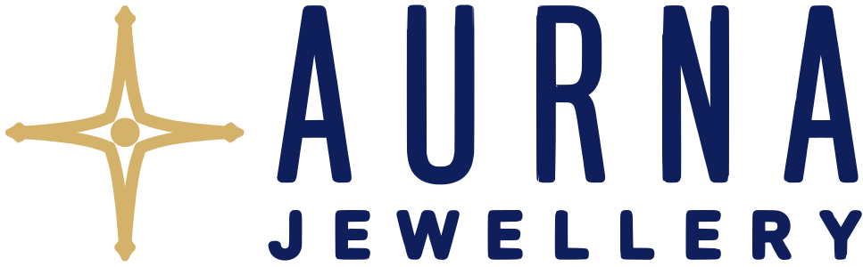
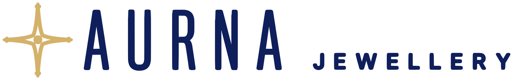

# AURNA logo files

Official AURNA Jewellery logo, with transparent backgrounds. Full usage rules are in **design.md, Section 2.2**.

| Element | Light backgrounds | Deep Navy backgrounds |
|---|---|---|
| Star mark | Jupiter Gold `#D4B26A` | Jupiter Gold `#D4B26A` |
| Wordmark | Deep Navy `#0F1F5C` | White `#FFFFFF` |

## Master logo: horizontal

The star, then **AURNA**, then **JEWELLERY** to the right, spread with wide letter-spacing and sitting on the AURNA baseline. This is the logo used on the website.

| File | Use |
|---|---|
| `aurna-logo-horizontal.svg` | **Master logo.** Website header (desktop), footer, mobile menu, any light background |
| `aurna-logo-horizontal-reversed.svg` | Master logo on Deep Navy (white wordmark, gold star) |
| `aurna-logo-horizontal.png` / `@2x` / `@3x` | Raster versions, 600 / 1200 / 1800 px wide: email signatures, documents, Google structured data |
| `aurna-logo-horizontal-reversed@2x.png` | Raster version on Deep Navy, 1200 px wide |

## Stacked versions (JEWELLERY under AURNA)

| File | Use |
|---|---|
| `aurna-logo-header.svg` / `aurna-logo-header-reversed.svg` | Stacked screen version. Used in the phone and tablet header, where the horizontal logo would be too small |
| `aurna-logo-bold.svg` / `aurna-logo-reversed-bold.svg` | Bold weight of the original stacked artwork |
| `aurna-logo.svg` / `aurna-logo.png` / `@2x` / `@3x` | Original stacked artwork as supplied. Use for print |
| `aurna-logo-reversed.svg` / `aurna-logo-reversed@2x.png` | Original stacked artwork on Deep Navy |
| `aurna-logo-navy.svg` | Original stacked artwork, single colour (all navy) |

## Mark and icons

| File | Use |
|---|---|
| `aurna-mark.svg` / `aurna-mark-512.png` | Star mark only |
| `favicon.ico`, `favicon-32.png`, `favicon-16.png` | Browser tab icons (thickened strokes) |
| `apple-touch-icon-180.png`, `app-icon-512.png` | Home-screen and app icons (gold star on navy) |

## On the website

**`<head>` on every page**

```html
<link rel="icon" href="/img/logo/favicon.ico" sizes="any">
<link rel="icon" type="image/png" sizes="32x32" href="/img/logo/favicon-32.png">
<link rel="icon" type="image/png" sizes="16x16" href="/img/logo/favicon-16.png">
<link rel="apple-touch-icon" href="/img/logo/apple-touch-icon-180.png">
```

**Header** (horizontal on desktop, stacked on phones and tablets)

```html
<a class="site-header__logo" href="/">
  <picture>
    <source media="(min-width: 1200px)" srcset="/img/logo/aurna-logo-horizontal.svg" width="422" height="66">
    
  </picture>
</a>
```

**Footer and mobile menu**

```html

```

## Rules in brief

- Never retype "AURNA" or "JEWELLERY" in a font; always use these files.
- Minimum 32 px tall for the stacked logo and 24 px for the horizontal logo; below that, use the star mark or favicon.
- Clear space: at least one star arm's width on every side.
- No stretching, recolouring, shadows, gradients or placing on photos.

*The horizontal and stacked screen versions were built from the supplied artwork (star resized, JEWELLERY enlarged and re-spaced). Before print production (packaging, stamping, signage), have a designer produce matching master vectors.*
